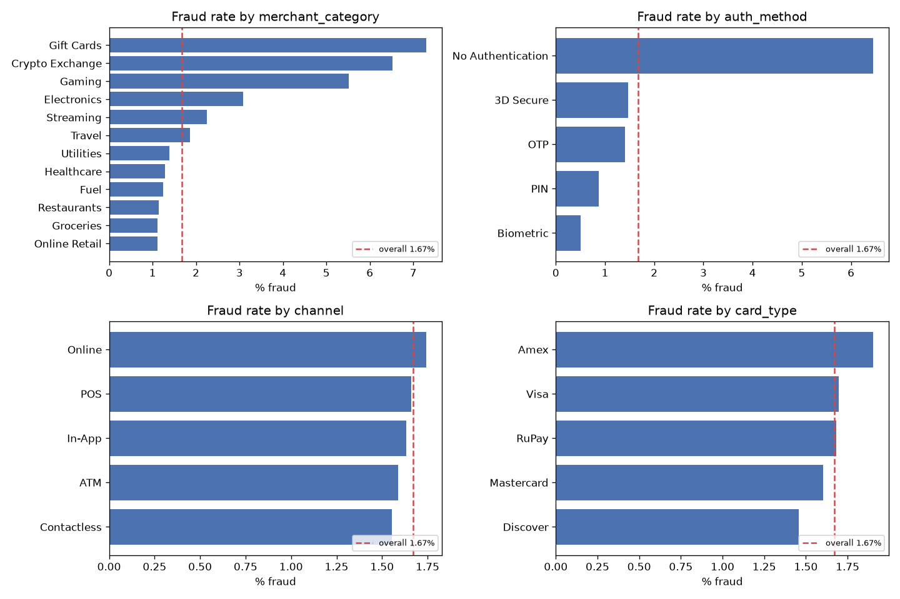
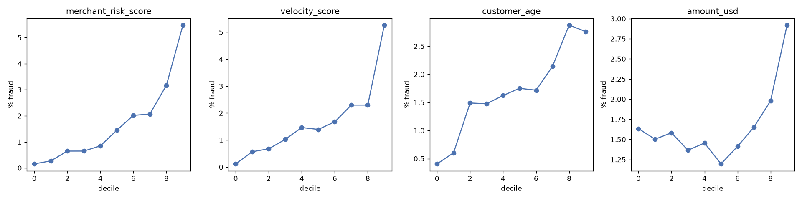
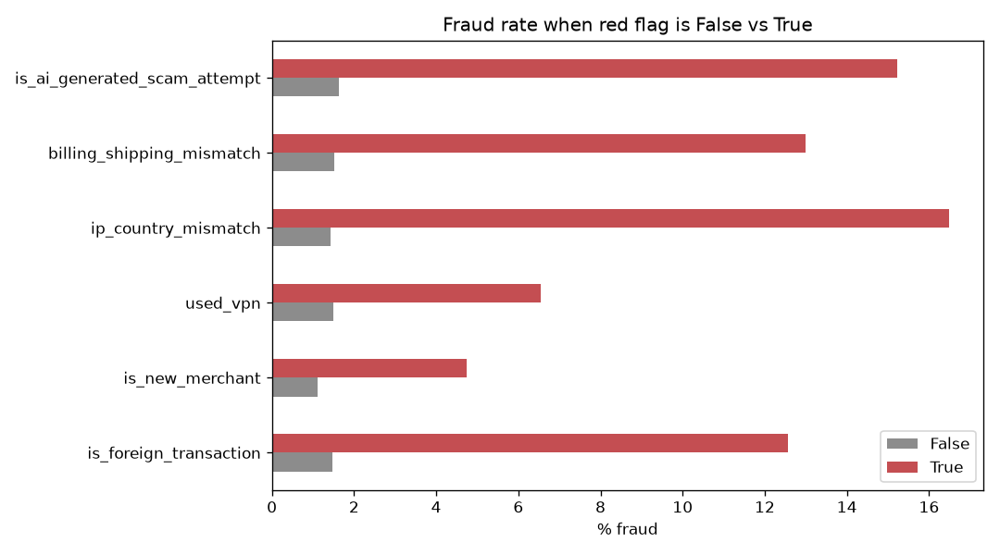

# Credit Card Fraud Detection — Kaggle Playground Series S6E11

Gradient-boosting ensemble (LightGBM + XGBoost + CatBoost) for the Kaggle competition
[Predicting Credit Card Fraud](https://www.kaggle.com/competitions/playground-series-s6e11)
(Playground Series, Season 6 Episode 11, November 2026).

The task is binary classification on ~700k card transactions with a **1.67% fraud rate**,
scored by **ROC AUC**.

## Results

| Version | What changed | 5-fold CV AUC | Public LB AUC |
|---|---|---|---|
| v1 | Domain features + LGB/XGB/CatBoost rank blend | 0.94696 | 0.94718 |
| v2 | + frequency encoding + nested out-of-fold target encoding + original dataset | **0.94827** | **0.94863** |

Per-model out-of-fold AUC (v2): LightGBM 0.94793 · XGBoost 0.94786 · CatBoost 0.94741.
Blend weights were optimised on the out-of-fold predictions (LGB 0.41 / XGB 0.26 / Cat 0.33).

Local CV and the public leaderboard agree to within 0.0004, so the validation setup is
trustworthy and the model is not tuned to the public leaderboard.

## Approach

### 1. Exploratory analysis (`src/eda.py`)



- Fraud is concentrated in **Gift Cards (7.3%)**, **Crypto Exchange (6.5%)** and **Gaming (5.5%)**,
  against roughly 1.1% for Groceries or Online Retail.
- **No Authentication** has a 6.4% fraud rate, versus 0.5% for Biometric.
- Channel, card type and device type carry almost no signal.



- `merchant_risk_score` and `velocity_score` are strongly monotonic, with a sharp jump in the top decile.
- Fraud risk rises with `customer_age`, and `amount_usd` is U-shaped.



### 2. Feature engineering (`src/features.py`)

- **Affordability:** `amount_to_balance`, log amount and log balance.
- **Activity bursts:** transactions per hour (`txn_rate`), velocity × transaction count.
- **Red-flag count:** the number of active risk indicators (VPN, IP mismatch, CVV retries, ...).
- **Time:** cyclical hour encoding (sin/cos), night and weekend flags.
- **Interactions:** no-authentication × merchant risk, distance × foreign transaction.
- **Frequency encoding:** how often each exact numeric value appears across train and test.
- **Target encoding:** each exact numeric value is treated as a category and given its
  smoothed fraud rate. To avoid leakage, it is fitted **only on the training fold**, with an
  inner 5-fold split, so a row never sees its own label. This gave the biggest single gain (+0.0013 AUC).

### 3. Modelling (`src/train.py`)

- Stratified 5-fold cross-validation, with early stopping on validation AUC.
- The competition data is synthetic, generated from a
  [20k-row original dataset](https://www.kaggle.com/datasets/uditjain13/credit-card-fraud-detection-2026).
  The original rows are added to every **training** fold only, so validation stays on
  competition data.
- Three gradient-boosted tree models, each using native categorical handling.
- The models are blended on **rank-normalised** predictions, since AUC only depends on ranking,
  with non-negative weights found by Nelder–Mead on the out-of-fold AUC.

### What did not help

- Cent and decimal-ending features, and exact-match lookups of the original dataset's labels:
  no gain on the holdout.
- Adding the original dataset without target encoding: neutral (±0.0001).

## Project structure

```
├── src/
│   ├── eda.py          # exploratory plots -> reports/figures/
│   ├── features.py     # feature engineering + leakage-safe target encoding
│   └── train.py        # 5-fold CV for LGB / XGB / CatBoost, blending, submission
├── reports/figures/    # EDA charts
├── outputs/            # CV scores, feature importances (predictions are git-ignored)
└── requirements.txt
```

## How to run

```bash
python -m venv .venv && source .venv/bin/activate
pip install -r requirements.txt

# Kaggle API token in ~/.kaggle/access_token, and the competition rules accepted on kaggle.com
kaggle competitions download -c playground-series-s6e11 -p data && unzip data/*.zip -d data
kaggle datasets download -d uditjain13/credit-card-fraud-detection-2026 \
    -p data/orig/credit-card-fraud-detection-2026 --unzip

python src/eda.py                 # figures
python src/train.py               # all three models (~10 min on a laptop CPU)
python src/train.py lgb           # or a single model
```

This writes `outputs/submission.csv`, `outputs/cv_scores.json` and feature importances.

## Tech stack

Python · pandas · NumPy · scikit-learn · LightGBM · XGBoost · CatBoost · SciPy · Matplotlib

## Acknowledgements

The community analysis in the competition's public notebooks pointed out the original source
dataset and the value of encoding exact numeric values. No code was copied from those notebooks; this is an independent
implementation.
